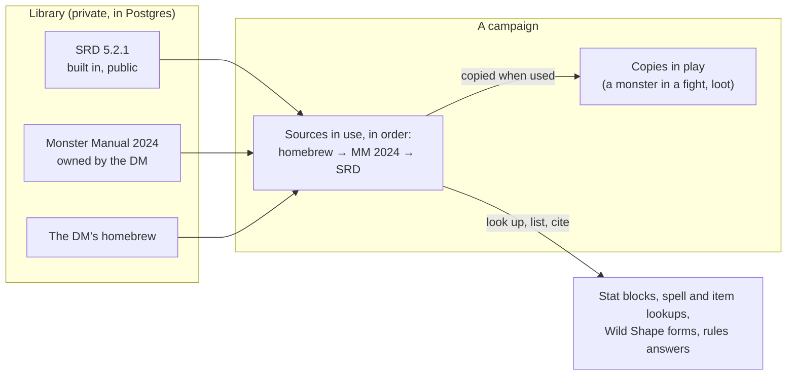

# Content sources: books, homebrew and the SRD (design for Brett's review, 2026-10-26)

**Superseded (2026-10-27)** by the data strategy (`docs/plans/2026-10-27-data-strategy.md`). Kept for the record.

Brett's questions: if the DM buys another book and the table starts using it, where is that content stored and how
is it used? What happens when the book is no longer used? Does it add to the core rules? Decide this now, before the
fight screen, stat blocks (2.3) and rules answers (5.1) are built on top of it.

## Today

- **The SRD 5.2.1** (the free part of the 2024 rules) is data in the repo (`app/data/srd/`): 331 monsters, 339
  spells, 258 magic items and the Rules Glossary.
- **A campaign's own content** (`campaign_content`): one table, rows per campaign, each a monster, spell or magic item
  with a `source` label ("Homebrew" or a book's title). A row with the same key as an SRD entry replaces it for that
  campaign. **It's empty and nothing writes to it yet**, so it can change freely.
- **Each character's own options** come from D&D Beyond: their sheet copy carries the full text of their subclass,
  feats, spells and items, whichever book they're from, plus their class's spell list.
- **House rules** (`house_rules`) are the DM's rulings, separate from content.

What's missing is the idea of a **book** as a thing in its own right: owned by someone, switched on or off per
campaign, kept when it's switched off, and citable.

## The model (proposed)

Four pieces:

| Piece | What it is | Example |
|---|---|---|
| **Source** | A book, an adventure, or a set of homebrew; who owns it, which edition | "Monster Manual (2024)", owned by Mary; "SRD 5.2.1", built in; "Mary's homebrew" |
| **Entry** | One thing from a source: a monster, spell, magic item, feat, subclass, background, or a section of rules text, with its page | "Adult Red Dragon", MM 2024 p. 252 |
| **Campaign's sources** | Which sources a campaign uses, in order, switched on or off by its DM | The Adventure Begins: Mary's homebrew → MM 2024 → SRD |
| **A copy in play** | When something is put into play (a monster in a fight, an item handed out), a copy of the entry as it was, with its source and page | Enemy 1: Adult Red Dragon, copied from MM 2024 p. 252 |

### Your questions

**The DM buys a book and the table starts using it.**
1. The book becomes a source in the DM's library, its entries brought in by an import (below) or typed in.
2. The DM switches it on for the campaign (Manage › Settings › Sources).
3. From then on it's part of every lookup in that campaign: its monsters on the fight screen and in stat blocks, its
   spells and items wherever spells and items are looked up, its beasts among Wild Shape's forms, and its text for
   rules answers, each showing where it's from ("MM 2024 p. 252").

**Where it's stored.** Postgres, in the private database, never the public repo. Large things (a book's page images
for rules answers) go in S3 under `v2/sources/<book>/`, private like the pictures. It's backed up with everything else.

**Who can see it.** Only the campaigns that switched it on. The owner can use it in any campaign they're the DM of,
the way D&D Beyond shares a DM's books with their campaigns. It never mixes into another table's campaign.

**The book is no longer used.** The DM switches it off: its entries drop out of lists, lookups and rules answers
for that campaign. Nothing is deleted: switching it back on restores it, and **anything already in play keeps its
copy**, so last month's dragon still has its stat block, labelled "from MM 2024 (no longer in use)". The owner can
delete a source only when no campaign uses it; copies in play survive even that.

**Does it add to the core rules?** It adds **options**: more monsters, spells, items, subclasses. It doesn't change
**rules**. A book's optional rule (say, a DMG variant for rests) becomes a **house rule** the DM switches on, with the
book as where it's from. That keeps "the DM makes every ruling" and one place where rules change.

**When a book's entry and the SRD's are the same thing** (the Monster Manual's Goblin and the SRD's Goblin), the
campaign's order decides: the first source that has it wins, and the page says which. A typo fix in the DM's homebrew
can override a book entry the same way.

### What it means for what's built

- `campaign_content` becomes **entries of a source**; each campaign's homebrew is a source owned by its DM. It's
  empty, so the change is a migration with nothing to move.
- `rules_data.catalog/find(kind, campaign)` keep their signatures: they read the campaign's sources in order instead
  of "campaign rows, then SRD". Every caller (Wild Shape, the roll audit, conditions, rule terms) gets books for free.
- The SRD stays as files in the repo (it's public, and tests read it without a database); it's registered as a
  built-in source so it sorts and cites like the others.
- New kinds join over time, each with a schema like today's: feat, subclass, background, species, and **rule
  section** (a book's text, chapter, heading and page) for rules answers.
- 2014-rules books can be sources, labelled with their edition; rules answers keep to 2024 unless the DM says
  otherwise (the product rule).

### Getting a book's content in (a separate decision, later)

Options, in order of effort:
1. **Type it in** on a Manage page, one entry at a time (fine for homebrew and a few monsters).
2. **Import a file** made on the Mac from a book the owner has on D&D Beyond (the way `private/books/` was made),
   uploaded straight to the database. It never touches the repo.
3. **Read it from the owner's D&D Beyond account** the way Foundry's DDB Importer does. Unofficial, can break, and
   needs the owner's D&D Beyond sign-in; only if 1 and 2 prove too slow.

### Not changing

- Characters still come from D&D Beyond with their own options' text; a book source matters most for the DM's side
  (monsters, items to hand out, lookups, rules answers).
- House rules and tool corrections stay as they are: rulings and fixes, not content.

## Decisions for Brett

1. Sources owned by a **person** (usable in any campaign they DM) rather than by one campaign. *Recommended.*
2. Switching a book off **hides** it and keeps copies already in play. *Recommended.*
3. A book's optional rules become **house rules** the DM switches on, rather than applying automatically. *Recommended.*
4. Build the model now (small: the table is empty) and the import later, when the DM first wants a book in.
